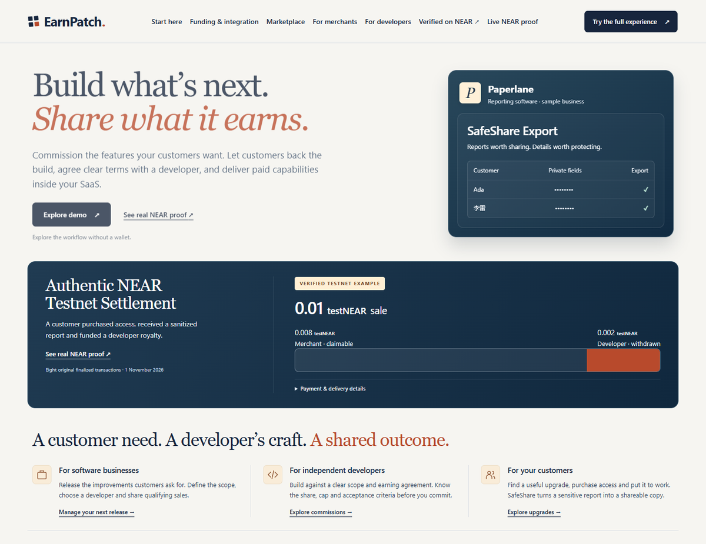
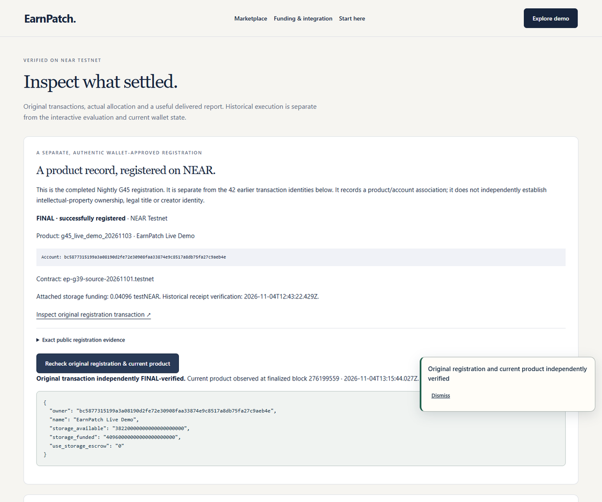
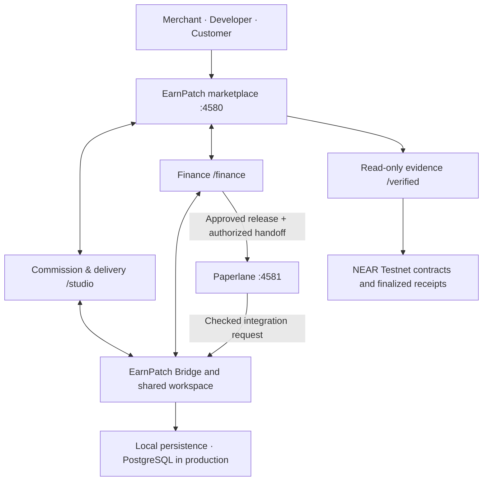

# EarnPatch

**Build what's next. Share what it earns.**

A merchant needs a software improvement. A developer can build it. Customers will pay to use it. EarnPatch puts those three decisions into one agreement: **what gets built, when it is accepted, and how much of each qualifying sale the developer earns—up to a fixed cap.**

The working prototype includes a marketplace, a commissioning and delivery workspace, a financing workspace, and **Paperlane**, a separate reporting app that uses the delivered feature. It also includes NEAR smart contracts and recorded NEAR Testnet payments. You can run the complete local evaluation without a wallet.

> **For reviewers:** local purchases, grants and payouts use simulated balances. The published NEAR Testnet transactions are real, but they are **separate historical executions**. This repository does not contain a wallet signer or enable new financial transactions.



**[Open EarnPatch — live product](https://earnpatch-production.up.railway.app/)**

The link opens EarnPatch's **main homepage**, not the walkthrough. The optional **Start here** guide is available in the site's navigation. Explore the merchant, developer and customer experience directly; for the connected Paperlane journey, complete the release and token-agreement steps in Finance and choose **Open token-checkout Paperlane**. Opening Paperlane separately does not attach that same approved workspace.

**Live evaluation:** Purchases, development commitments and payouts use simulated balances. SafeShare produces genuinely transformed CSV files. Original NEAR Testnet receipts and the G45 registration remain separate, authentic **read-only** evidence; the public app does not request wallet signatures.

**Explore the repository:** [Run locally](#run-it) · [Walk through a complete sale](#follow-a-feature-from-commission-to-customer) · [Check the money](#the-money-in-one-example) · [Verify the NEAR transactions](#verify-the-near-testnet-records) · [Run the tests](#reproduce-the-checks)

## The important part in 30 seconds

Consider **SafeShare Export**, a feature for removing selected fields from a CSV before sharing it.

The merchant commissions the feature. The developer accepts the terms and submits the release. The merchant approves it. A customer buys one use and downloads an **actually processed CSV**, not a placeholder file.

Under the native-price example in the local evaluation, a **0.01 NEAR** purchase is allocated as follows:

| One customer purchase | Allocation |
| --- | ---: |
| Merchant | **0.008 NEAR** |
| Developer | **0.002 NEAR** |
| **Total** | **0.010 NEAR** |

The developer's agreed share is **20%**, capped at **0.004 NEAR** in total. Two qualifying sales reach the cap; later sales no longer add developer royalties under that agreement. The cap is enforced by the accounting rules, not by a display calculation.

**Those numbers are from the simulated native-price evaluation.** A separate, recorded NEAR Testnet purchase shows the same 0.008/0.002 allocation with actual blockchain receipts. The two demonstrations should not be mistaken for a single transaction.

That is the idea behind EarnPatch: **a delivered improvement can keep earning for its developer, without creating an unlimited claim on the merchant's future sales.**

### Why NEAR belongs here

After a feature ships, the merchant runs the storefront, but the developer may still be entitled to part of its sales. A private dashboard can *report* those allocations; a contract can enforce the agreed cap and leave settlement records open to inspection. EarnPatch's NEAR Testnet contracts demonstrate development commitments, purchases, refunds and withdrawals—not just a wallet connection on a landing page.

The local evaluator lets a judge exercise those rules without spending cryptocurrency. The [original Testnet records](#verify-the-near-testnet-records) establish what was separately executed on-chain. Neither is presented as a production mainnet payment system.

## Run it

**You need:** Git, Node.js **22+**, npm, and a browser. You do **not** need a NEAR account, faucet tokens, credentials, PostgreSQL, Docker or Rust to try the product.

```bash
git clone https://github.com/chizzydev/earnpatch.git
cd earnpatch
npm ci
npm run build
npm start
```

The build should report `G40_BUILD_PASS`. The launcher starts two services on your machine. Leave that terminal open.

| Open | Address | What you'll find |
| --- | --- | --- |
| **Start guide** | http://127.0.0.1:4580/start | Instructions inside the running app |
| **EarnPatch** | http://127.0.0.1:4580 | Merchant, developer and customer experience |
| **Commission & delivery** | http://127.0.0.1:4580/studio | Shared agreement, submission and approval |
| **Finance** | http://127.0.0.1:4580/finance | Simulated grants, royalties, caps and token agreement |
| **Paperlane** | http://127.0.0.1:4581 | Separate SaaS, connected through an authorized handoff |
| **Verified on NEAR** | http://127.0.0.1:4580/verified | Original transaction links and read-only chain checks |

**One product, two local services.** EarnPatch, Studio and Finance share the current evaluation workspace. Paperlane runs separately and connects to that approved workspace through EarnPatch Bridge. Opening Paperlane on its own does not automatically import your current agreement; use the handoff from Finance.

On Windows, the same four application surfaces are available at these addresses. Stop the launcher with **Ctrl+C**. If the default ports are occupied, set `EARNPATCH_LOCAL_PORT` and `PAPERLANE_LOCAL_PORT` before starting; [OPERATIONS.md](OPERATIONS.md) has the details.

**Why the port numbers sometimes differ:** `4580` (EarnPatch) and `4581` (Paperlane) are the defaults for a fresh local `npm start`. An isolated review or recording session may choose different free ports without changing the product or its published defaults. For example, in PowerShell, set `$env:EARNPATCH_LOCAL_PORT='4590'` and `$env:PAPERLANE_LOCAL_PORT='4591'` before `npm start`, then use those two localhost ports instead. The public Railway URLs do not use these local overrides.

## Follow a feature from commission to customer

Use a fresh browser session. The fictional merchant, developer, customer and reporting data are included. There is no need to create accounts or connect a wallet.

| Step | Do this | What should happen |
| --- | --- | --- |
| **1. Open the commission** | Visit [Studio](http://127.0.0.1:4580/studio). A new workspace has an open SafeShare invitation. | You can inspect the requirements and commercial terms before accepting them. |
| **2. Accept and deliver** | Switch to **Developer**, accept the agreement, and submit the bundled SafeShare release. | Studio records the accepted terms and identifies the release by its artifact hash. It does **not** execute arbitrary uploaded code. |
| **Optional merchant test** | While the delivery is Submitted, switch to Merchant and choose **Test submitted release**. Load the fictional sample or paste CSV, preview it, select redactions and run the acceptance test. | Inspect the actual transformed CSV and exact submitted artifact before returning to approval. No purchase, credit use, royalty or publication occurs. |
| **3. Approve** | Switch to **Merchant**, inspect the release and acceptance criteria, check the review confirmation, and approve. | Customer access becomes available. Developer acceptance and merchant approval are different actions. |
| **4. Buy a use** | Open the [Customer](http://127.0.0.1:4580/#customer) view and buy a simulated native-price SafeShare use. | One export credit appears; merchant and developer balances reflect the agreed split. |
| **5. Use the feature** | Open SafeShare Export, paste the CSV below, preview, select **email** and **account_id** (zero-based columns **1 and 2**) to redact, confirm the policy, process and download. | The resulting CSV is genuinely transformed. The downloaded file is the useful result of the purchase. |
| **6. Connect Paperlane** | In [Finance](http://127.0.0.1:4580/finance), import the approved release as **Merchant**; accept Paperlane's separate TestEPUSD terms as **Developer**. Select **Open token-checkout Paperlane**. | The approved SafeShare feature and its token agreement are handed to the independent Paperlane app. |
| **7. Buy through Paperlane** | In Paperlane, purchase a simulated token-priced use, supply CSV input, review the redaction policy, process and download. Return to Finance. | Paperlane supplies a real download while Finance shows the separate token accounting. A native credit cannot be spent as a token credit. |
| **8. Check the chain evidence** | Visit [Verified on NEAR](http://127.0.0.1:4580/verified) and open the original transaction links. | You can distinguish historical on-chain settlement from the evaluation you just completed. |

**Optional acceptance sandbox:** This was added after the recorded demo; the existing video is unchanged and does not demonstrate it. It runs the same hash-pinned SafeShare engine as paid export processing and never executes uploaded developer code. Access is checked against the server-side Merchant evaluation persona, current workspace, Submitted stage and exact artifact. Evaluation role switching remains intentional; this is not wallet-based merchant authentication. Review requests are limited to 20 KB, 100 data rows and 20 processing runs per delivery. The panel has no export-download action. Source and transformed data are held only on the current page and cleared when you change roles or leave it; only the review binding, expiry and run count are retained server-side. Closing the panel returns to the existing approval controls without approving or publishing anything.

**CSV for step 5** (fictional input):

```csv
label,email,account_id,notes,total
Ada,ada@example.test,customer_104,"=SUM(1,2)",42
李雷,lee@example.test,customer_105,"Shared, approved",19
```

**Check the download:** columns `email` and `account_id` are redacted; `李雷` remains readable; the `=SUM(1,2)` entry is neutralized for spreadsheet use; and the original email addresses no longer appear. The processor supports selected columns and pattern checks, but it cannot promise to find every sensitive value. Inspect the export before sharing it.

**Want to write your own commission instead?** In Studio, switch to Merchant and choose **Reset this workspace**, then create a new brief. Reset starts a different evaluation scenario in your current local or hosted session; it does not change the NEAR Testnet records. The built-in [start guide](http://127.0.0.1:4580/start) explains the difference between the existing invitation and a new draft.

## The money in one example

EarnPatch keeps **development funding** separate from **feature sales**. An early supporter can fund work without automatically receiving export credits. A customer purchase creates an entitlement under the approved sales agreement, not a development-grant contribution.

The local evaluation offers two sale agreements for the *same* delivered SafeShare feature:

| | Native-price evaluation | Paperlane token evaluation |
| --- | --- | --- |
| Price per use | 0.01 NEAR | 0.007 TestEPUSD |
| Developer share | 20% | 25% |
| Developer earnings cap | 0.004 NEAR | 0.003 TestEPUSD |
| What the customer receives | One native-priced export use | One token-priced export use |
| Settlement in local evaluation | **Simulated** | **Simulated** |

The token cap is easier to see over several purchases. Each use costs **0.007 TestEPUSD**:

| Purchase | Developer receives | Merchant receives | Developer total |
| --- | ---: | ---: | ---: |
| First | 0.00175 | 0.00525 | 0.00175 |
| Second | 0.00125 | 0.00575 | **0.00300 — cap reached** |
| Third | 0 | 0.00700 | 0.00300 |
| **Three-sale total** | **0.003** | **0.018** | |

The first purchase pays the full 25% share. On the second, only the amount left under the cap is allocated to the developer. The third adds nothing to developer royalties. The separately recorded Testnet campaign includes three token purchases totaling **0.021 TestEPUSD**, along with the corresponding withdrawal receipts. The local evaluation reproduces the rule without moving tokens.

**TestEPUSD is a custom NEAR Testnet token with no redemption value. It is not USD, USDC or a real stablecoin.**

Finance also supports a distinct funding/refund case: a **0.02 NEAR** development goal with two fictional supporters committing **0.01 NEAR** each. After the approved release and the required consent/deadline conditions, one commitment can be released and the other refunded. Neither creates a sale or an export credit. This scenario is covered by the workflow tests and can be explored through Finance's advanced controls.

## Verify the NEAR Testnet records

The public release makes two kinds of claims, backed by different evidence:

- **Reproducible local behavior:** launch the app, complete the role changes, download a CSV and inspect simulated allocations.
- **Recorded blockchain behavior:** follow original NEAR Testnet transaction hashes and read the finalized state of deployed contracts. The public release cannot replay owner-approved wallet actions.

### A completed wallet-approved product registration



A Nightly wallet approved a `create_product` call. Its original transaction has finalized successfully, and a later contract read returned the matching product.

| Field | Original recorded value |
| --- | --- |
| Transaction | [`4jd1JJ7fshiLPht1DkErJ3NKBQGVx8R8oNBczUDww9oW`](https://testnet.nearblocks.io/txns/4jd1JJ7fshiLPht1DkErJ3NKBQGVx8R8oNBczUDww9oW) |
| Network | NEAR **Testnet** |
| Signer | `bc5877315199a3a08190d2fe72e30908faa33874e9c8517a8db75fa27c9aeb4e` |
| Contract | `ep-g39-source-20261101.testnet` |
| Method | `create_product` |
| Product | `g45_live_demo_20261103` — EarnPatch Live Demo |
| Attached deposit | 0.04096 testNEAR, for contract storage |

The source record is [`g40/public/registration-proof.json`](g40/public/registration-proof.json). The [verification code](g40/registration.mjs) checks the **original transaction hash**, signer, receiver, exact function arguments, deposit, gas, successful receipt identities and accepted contract code. It also reads the product from the finalized chain state.

```bash
npm run verify:proof
```

**Expected:** with access to NEAR Testnet RPC, the command exits `0` and reports `"final_execution_status": "FINAL"` for the recorded transaction. It does not request a wallet signature. If the RPC cannot be reached or the returned evidence does not match, verification fails rather than reporting success. If a block explorer rejects an automated request, use this RPC-based command or the application's read-only verification; explorer availability alone does not establish transaction finality.

**What this proves:** the account registered a product record in the named contract. **It does not establish copyright, legal ownership, creator identity, or that every local evaluation payment happened on-chain.**

### Historical funding, purchases and payouts

The separate [`g40/public/testnet-proof.json`](g40/public/testnet-proof.json) lists **42 finalized transaction identities**. They cover contract deployment, development commitments, delivery, purchases, refunds, expected rejections and withdrawals. **Forty-two identities do not mean forty-two successful purchases.** Each record retains its actual outcome. An earlier wrong-price attempt remains **UNKNOWN** and is explicitly outside these 42 finalized identities; the separately finalized additional attempt does not resolve that original uncertainty.

A separate native lifecycle contains a real **0.01 testNEAR** purchase with **0.008 testNEAR** allocated to the merchant and **0.002 testNEAR** paid to the developer. In the token campaign, three **TestEPUSD** purchases totaled **0.021**, with **0.003** in developer royalties and **0.018** in merchant proceeds; both accounts' withdrawal transactions have their own hashes.

[Open the evidence page](http://127.0.0.1:4580/verified) to inspect those records and query current finalized contract state. The completed registration above is **separate from those 42 identities**.

| Contract | NEAR Testnet account |
| --- | --- |
| Product/source marketplace | `ep-g39-source-20261101.testnet` |
| Development escrow | `ep-g38-escrow-20261101.testnet` |
| Token settlement | `ep-g38-token-20261101.testnet` |
| Custom test token | `testusd.ep-g39-source-20261101.testnet` |

These records demonstrate **Testnet** behavior. They are not production revenue, live customers, or mainnet payments.

## How the application is put together



The important connection is **the approved feature**, not merely navigation between pages. The same SafeShare release is commissioned and accepted, becomes available for native-price use, and can be imported into a distinct token agreement for Paperlane. Paperlane is a separate service; its Bridge handoff is checked rather than assumed.

The accounting rules also enforce boundaries that a UI cannot override:

| Action | Condition that matters |
| --- | --- |
| Developer delivery | The developer must accept the agreed terms before submitting the named release. |
| Merchant approval | The merchant reviews the submitted release and acceptance criteria. |
| Customer purchase | The approved feature, correct asset/price, buyer role and non-replayed order are checked. |
| Developer royalties | Every allocation respects the agreement's share and remaining cap. |
| CSV export | The purchaser needs an unused entitlement and must confirm the redaction policy. |
| Development grant | Release/refund conditions are checked separately from customer sales. |
| External wallet action | **Not available** in the public reviewer application; original Testnet records are read-only. |

### Where the source lives

| Path | Responsibility |
| --- | --- |
| [`g36/site`](g36/site) | Marketplace and three-role customer experience |
| [`g37/studio`](g37/studio), [`g37/bridge`](g37/bridge) | Commissioning, delivery, merchant approval and Bridge integration |
| [`g37/paperlane`](g37/paperlane) | Independent SaaS and its SafeShare export flow |
| [`g38`](g38), [`g39`](g39) | Financial rules, contracts and persistence |
| [`g40`](g40), [`scripts`](scripts) | Local server, deployment packaging, database tests, public transaction records and read-only verification |
| [`g41`](g41) | Evaluation state and cross-application test coverage |
| [`marketplace_v2`](marketplace_v2), [`g38/contracts`](g38/contracts), [`g38/test-token`](g38/test-token) | Rust NEAR contract source and test-token implementation |

The numbered directories reflect engineering stages; they are **not** separate applications a reviewer must assemble manually. `npm run build` packages their required imports. The repository keeps accepted WASM artifacts and SHA-256 fingerprints for integrity checks.

**Stack:** Node.js/ES modules, browser JavaScript/CSS, PostgreSQL for the hosted configuration, Rust/near-sdk smart contracts, and NEAR Testnet for the recorded chain executions. Paperlane and EarnPatch use distinct service entry points.

### Third-party dependencies

The implementation uses [Node.js](https://nodejs.org/) and [node-postgres (`pg` 8.16.3)](https://github.com/brianc/node-postgres) for the application and database adapter. Contract source uses [NEAR SDK 5.29.1](https://github.com/near/near-sdk-rs) and `near-contract-standards` 5.29.1 for the test token. [Playwright 1.61.1](https://github.com/microsoft/playwright) is used only for automated browser verification. PostgreSQL and the official Node/PostgreSQL container images support the optional deployment and database checks. The dependency manifests and lockfiles record the exact package versions; third-party components retain their own licenses.

The SafeShare engine and bundled release are included under [`apps/earnpatch`](apps/earnpatch); the public demonstration does not depend on a private CSV-processing service or execute arbitrary uploaded code.

## Reproduce the checks

For the build, automated application tests and source-integrity checks, run:

```bash
npm ci
npm test
npm run verify
```

`npm test` runs the build first. The accepted application passed **50/50 tests** during fresh-clone qualification and again on **November 6, 2026**. The merchant acceptance improvement adds eight focused API/security tests, bringing the application suite to **58 tests**. Browser acceptance is a separate gate. Browser, HTTPS, PostgreSQL, Docker and live read-only proof checks are separate commands below; they are not implied by the unit-test count.

| Command | Checks | Extra requirement |
| --- | --- | --- |
| `npm run build` | Creates the allowlisted release and reports `G40_BUILD_PASS` | Node.js 22+ |
| `npm test` | Role transitions, payments and caps, duplicate handling, registration verification and release safeguards | No wallet |
| `npm run verify` | Source/WASM SHA-256, approved public-file list and basic credential patterns | Git checkout |
| `npm run verify:package` | Every required input for the generated Docker context | Run build first |
| `npm run test:browser` | HTTPS evidence-page and Paperlane browser checks, real CSV download and mobile overflow | Installed Microsoft Edge and OpenSSL |
| `npm run test:evaluation` | Connected merchant/developer/customer UI journeys, native and Paperlane CSV downloads, reload recovery | Installed Microsoft Edge |
| `npm run test:acceptance` | Submitted-release merchant sandbox, authorization feedback and the subsequent Customer/Finance/Paperlane workflow | Installed Microsoft Edge |
| `npm run test:https` | HTTPS and actual file downloads | OpenSSL |
| `npm run test:wasm` | Accepted WASMs through the shipped host checks | No new Rust compilation |
| `npm run verify:proof` | The exact G45 registration and current finalized product state | Public NEAR Testnet RPC |
| `npm run test:postgres` | Disposable PostgreSQL integration and restart persistence | PostgreSQL 16+ binaries and OpenSSL |
| `npm run test:container` | Docker image, EarnPatch + Paperlane + PostgreSQL and recovery | Docker daemon; disposable resources |

**Windows:**

```powershell
powershell.exe -NoProfile -ExecutionPolicy Bypass -File .\scripts\WINDOWS_VERIFY.ps1 -Browser -ReadOnlyProof
```

`-Postgres` and `-Container` are optional. Without them, those checks show `NOT_REQUESTED`; the Windows command does not silently run them. The separate PostgreSQL **16.15** and actual Docker three-service runs passed during release qualification. Hosted Railway acceptance was verified separately on **November 6, 2026**; local test results alone do not establish hosted availability.

[OPERATIONS.md](OPERATIONS.md) covers alternate ports, PostgreSQL dependencies, production deployment variables and failure recovery. The repository includes deployment configuration and a publicly accessible Railway deployment. EarnPatch is available at [https://earnpatch-production.up.railway.app/](https://earnpatch-production.up.railway.app/), with Paperlane operating as a separate connected service.

A production PostgreSQL logical backup and isolated restore were successfully verified on November 6, 2026. Native Railway volume restoration remains untested, and automatic backups are not currently enabled. See [OPERATIONS.md](OPERATIONS.md) for the recovery evidence and operational details.

## What is implemented—and what isn't

- **Working in local and hosted wallet-free evaluation:** merchant/developer/customer workflows, separate conditional funding, capped simulated royalties, real SafeShare CSV transformation, Paperlane integration, restart recovery and read-only blockchain verification.
- **Recorded on NEAR Testnet:** actual contract transactions, escrow and purchase results, royalty withdrawals, and the separately approved product registration.
- **Not part of this public build:** private owner-wallet authorization, a new financial-signing flow, live customer money, mainnet settlement, production billing, and a hosted deployment guarantee.
- **Data handling:** CSV input is processed for the requested export, not saved as reusable raw customer uploads. Digests and other operation metadata may be retained. Evaluation sessions and their workspace state expire after **24 hours**. Pattern redaction is not a promise of complete anonymization.

### What a real pilot should measure

The prototype has no claimed customer traction or measured commercial impact yet. A pilot with a merchant and developer should track **time from commission to accepted delivery**, **paid use of the released feature**, **developer earnings against the agreed cap**, and **whether development commitments are released or refunded correctly**. The question is whether tying developer earnings to accepted, used software leads to better outcomes than treating the job and the subsequent sales as unrelated.

## Licensing and ownership

Copyright (c) 2026 ChizzyDev. All rights reserved.

This public repository is available for review of the EarnPatch prototype, including hackathon judging. **No open-source license has been granted** for the project code. Public visibility does not generally authorize copying, modifying, redistributing or commercially reusing the code. Contact the project owner for licensing permission. Third-party components remain subject to their own licenses. See [LICENSE](LICENSE) for the same owner-approved policy.

---

Built for the [NEAR Hackathon 2026](https://nearhackathon.com/). The public repository contains the buildable evaluator experience and checkable Testnet history; the Nightly signing tools used for the original registration are excluded from this release. [Explore EarnPatch live](https://earnpatch-production.up.railway.app/), [run it locally](#run-it), or [inspect the transactions](#verify-the-near-testnet-records).
